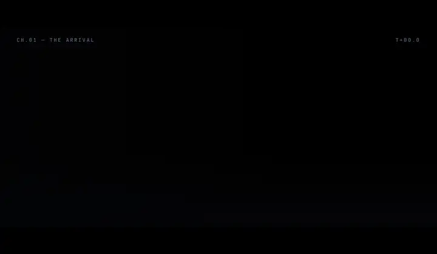
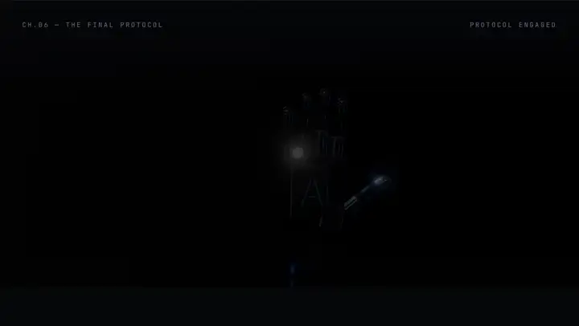

<!--
  PROJECT AETHER — profile README of @Muhammad-Adil-Abir.
  Generated parts (refreshed daily by .github/workflows/aether.yml — do not edit by hand):
    • assets/readme/singularity.svg        black-hole banner, one particle per real day
    • assets/readme/launch-archive-*.svg   real contribution data
    • the block between the AETHER:PROJECTS markers   real public repositories
  Everything else is written by hand and safe to edit.
-->

  <a href="https://muhammad-adil-abir.github.io/Muhammad-Adil-Abir/"><b>Enter the interactive world →</b></a>
  &nbsp;·&nbsp;
  One particle per day of real GitHub activity — brighter streaks are busier days. Regenerated daily.

 

### `CH.01` — The Arrival

The live site plays the full real-time 3D experience; this is its recorded trailer.

 

### `CH.02` — Curiosity, *engineered.*

I'm **Adil Akhtab Abir** — an IT student building toward production-grade software:
websites, applications, automation systems and AI agents, from the first commit to systems people can depend on.

> *A world built on curiosity, code, and possibility.* 
> `// Some people launch missiles. I launch ideas.`

| `P-01` Accuracy | `P-02` Reliability | `P-03` Security | `P-04` Maintainability |
|:--|:--|:--|:--|
| No invented APIs, numbers or facts. Verify first, then build. | Tests, type checks and a passing build before anything is called done. | Secrets stay out of code. Protections stay switched on. | Modular, readable code the next engineer can trust and extend. |

 

### `CH.03` — Disciplines

| `D-01` | `D-02` | `D-03` | `D-04` |
|:--|:--|:--|:--|
| **Web & Application Engineering** — responsive, accessible, fast on every screen. | **Automation Systems** — clear inputs and outputs, careful retries, honest logs. | **AI Agents** — scoped permissions, human approval for anything destructive. | **Software Architecture** — requirements, dependencies and risks mapped into milestones. |

#### Selected launches

<!-- AETHER:PROJECTS:START -->
| | Launch | Mission | Stack |
|:--|:--|:--|:--|
| `W-01` | <a href="https://github.com/Muhammad-Adil-Abir/CodeWithAbir"><b>CodeWithAbir</b></a> | This is my first Git Repository. | HTML |
<!-- AETHER:PROJECTS:END -->

 

### `CH.04` — The Launch Archive

<picture>
  <source media="(prefers-color-scheme: dark)" srcset="assets/readme/launch-archive-dark.svg">
  <source media="(prefers-color-scheme: light)" srcset="assets/readme/launch-archive-light.svg">
  
</picture>

Real contribution data, regenerated daily from GitHub. Empty pads are quiet days; vehicles are days with contributions — the busier the day, the higher and brighter it flies. <a href="https://muhammad-adil-abir.github.io/Muhammad-Adil-Abir/#archive">Explore it interactively →</a>

 

### `CH.05` — Open a *channel*

<a href="https://github.com/Muhammad-Adil-Abir">GitHub · @Muhammad-Adil-Abir</a>

 

  <b>EVERY ENDING IS A NEW BEGINNING.</b> 
  THE WORK IS NEVER DONE. 
  — ADIL AKHTAB ABIR

<i>Thank you for stepping into my world.</i> · <a href="docs/SETUP.md">How this profile is built</a>

