<!--
  Profile README — "Where the mind is without fear"
  Every panel is a self-contained animated SVG in assets/profile/ (fonts and images embedded).
  The snake animation is generated by .github/workflows/snake.yml into the `output` branch.
-->

 

  

<!-- 01 — MANIFESTO -->

  

<!-- 02 — ARSENAL -->

  

<!-- 03 — SELECTED WORK -->

  

<!-- 04 — SIGNAL (live GitHub data) -->

  

<picture>
  <source media="(prefers-color-scheme: dark)" srcset="https://raw.githubusercontent.com/Muhammad-Adil-Abir/Muhammad-Adil-Abir/output/snake-dark.svg" />
  <source media="(prefers-color-scheme: light)" srcset="https://raw.githubusercontent.com/Muhammad-Adil-Abir/Muhammad-Adil-Abir/output/snake-light.svg" />
  
</picture>

  

<!-- 05 — OPEN A CHANNEL -->

<!--
  ✍️ ADD YOUR CONTACT DETAILS HERE (this block is intentionally empty).
  Example — copy a line, remove the comment markers, replace the placeholder:

  
  
-->

  

